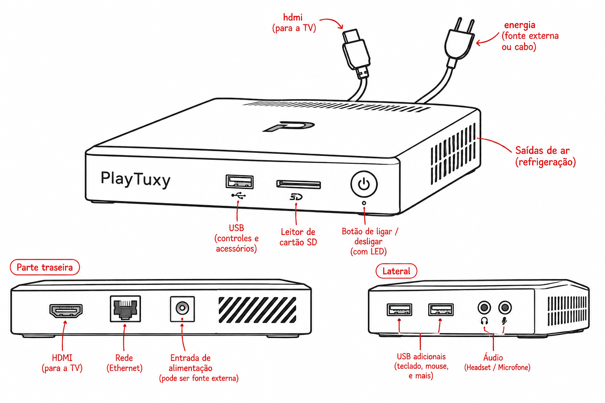

# PlayTuxy — documentação do projeto

**Projeto:** PlayTuxy  
**Tipo:** sistema operacional de console para PC  
**Arquitetura-alvo:** x86_64  
**Estado atual:** kernel mínimo inicializável; desenvolvimento em estágio inicial.

## Concept do console

A imagem abaixo representa o conceito físico planejado para o PlayTuxy: um console compacto para TV, com HDMI, Ethernet, alimentação, USB, leitor SD, áudio e ventilação.




## 1. Visão do projeto

O PlayTuxy é um sistema operacional baseado em Linux, planejado para transformar um computador compacto conectado à TV por HDMI em uma experiência de console. A proposta é iniciar diretamente em uma interface própria, simples de navegar com controle, sem exigir que a pessoa use uma área de trabalho tradicional.

A meta é oferecer uma experiência de sala de estar para jogos de PC. A compatibilidade com jogos e programas de Windows deverá ser obtida futuramente por meio de tecnologias como Steam e Proton, executadas sobre uma distribuição Linux e seus drivers. Isso é um objetivo de projeto, não uma capacidade já implementada.

## 2. Como deverá ser

### Experiência de uso planejada

- Inicialização direta em uma interface de console.
- Navegação por controle, com foco em TV e uso à distância.
- Biblioteca de jogos e atalhos para aplicativos.
- Configurações acessíveis pela interface: vídeo, áudio, rede, controles e armazenamento.
- Atualizações do sistema e recuperação em caso de falha.
- Possibilidade de sair para ferramentas de manutenção, sem transformar a experiência principal em um desktop comum.

### Base técnica pretendida

| Área | Direção planejada |
|---|---|
| Arquitetura | x86_64 |
| Base do sistema | Linux |
| Interface | Shell/launcher próprio, otimizado para TV |
| Jogos | Steam e Proton, quando compatíveis |
| Gráficos | Mesa e drivers adequados à GPU |
| Entrada | Controles USB/Bluetooth e teclado para manutenção |
| Áudio | Stack de áudio do Linux |
| Distribuição | Imagem inicializável e, futuramente, instalador para SSD |

Essas escolhas são a direção prevista; não estão todas presentes no protótipo atual.

## 3. Estado real do protótipo

O primeiro protótipo entregue é muito menor que o sistema final. Ele contém:

- Um cabeçalho Multiboot2 para o GRUB.
- Código de inicialização x86_64 que prepara o modo longo.
- Um kernel C freestanding mínimo.
- Saída de diagnóstico pela porta serial (COM1).
- Configuração do GRUB para carregar o kernel.
- Workflow do GitHub Actions para compilar e empacotar uma ISO.

O build do GitHub Actions foi concluído com sucesso e o teste em QEMU mostrou a mensagem do kernel no terminal do Termux:

```text
====================================
             PlayTuxy
====================================
Kernel x86_64 iniciado com sucesso.
Esta e a primeira base inicializavel.
Proxima etapa: framebuffer e entrada.
```

Isso comprova que o GRUB carregou o kernel e que o código do kernel começou a executar. **Não comprova que exista uma interface gráfica ou um sistema operacional completo.**

### O que ainda não está implementado

- Framebuffer/saída gráfica do kernel.
- Interface visual do PlayTuxy.
- Teclado e controle como dispositivos de entrada do sistema.
- Gerenciamento de processos e memória avançado.
- Armazenamento, sistema de arquivos e instalação.
- Rede, Bluetooth e áudio.
- Steam, Proton e execução de jogos.
- Atualizador e recuperação do sistema.

A tela preta no bVNC é esperada nesta etapa: a mensagem atual é enviada pela porta serial, não para a tela virtual.

## 4. Estrutura do projeto inicial

```text
PlayTuxy/
├── .github/
│   └── workflows/
│       └── build.yml
├── boot/
│   └── boot.S
├── grub/
│   └── grub.cfg
├── kernel/
│   └── kernel.c
├── .gitignore
├── linker.ld
└── README.md
```

- `boot/boot.S`: entrada e preparação inicial da CPU.
- `kernel/kernel.c`: ponto de entrada do kernel e mensagens seriais.
- `linker.ld`: organização e endereçamento do kernel.
- `grub/grub.cfg`: menu e instrução para carregar o kernel.
- `.github/workflows/build.yml`: compilação e geração da ISO no GitHub Actions.

## 5. Etapas de desenvolvimento previstas

1. **Base inicializável** — kernel carregado pelo GRUB e diagnóstico serial. Concluída no protótipo.
2. **Vídeo básico** — solicitar um modo gráfico ao GRUB, obter os dados do framebuffer e desenhar pixels/texto.
3. **Entrada** — detectar teclado e controles e criar uma camada de eventos.
4. **Fundação do sistema** — interrupções, temporizador, memória, alocação e drivers essenciais.
5. **Interface PlayTuxy** — tela inicial, navegação por controle, configurações e biblioteca.
6. **Base Linux para uso real** — integrar a interface a uma distribuição Linux x86_64 com drivers e serviços.
7. **Jogos e compatibilidade** — integrar Steam/Proton e testar jogos compatíveis.
8. **Instalação e atualização** — criar imagem instalável, atualização segura e recuperação.

**Observação importante:** o protótipo de kernel próprio é uma etapa de aprendizado e validação de inicialização. Para alcançar compatibilidade ampla com jogos de PC, a direção planejada é usar Linux como base do sistema final, não tentar reimplementar do zero todos os drivers, serviços e compatibilidade de um sistema moderno.

## 6. Compilação e teste atuais

O workflow do GitHub Actions compila o kernel e cria uma ISO inicializável. A ISO é um meio de teste/distribuição, não significa que o PlayTuxy final será limitado a rodar como um arquivo ISO.

O teste atual em QEMU usa emulação x86_64. A saída serial aparece no Termux. A janela VNC pode permanecer preta enquanto não houver saída gráfica implementada.

## 7. Metas de hardware

A meta geral é um PC compacto x86_64 ligado à TV por HDMI, com desempenho intermediário. Uma configuração de referência discutida anteriormente foi Ryzen 5 7600, Radeon RX 6600 8 GB, 32 GB DDR5 e SSD NVMe de 1 TB. Essa configuração é apenas uma referência de planejamento, não uma exigência final nem hardware já adquirido/testado.

## 8. O que significa “build concluído”

Um build verde confirma que as etapas automatizadas de compilação, verificação Multiboot2 e empacotamento da ISO terminaram sem erro. Ele não garante, sozinho, que todos os recursos planejados existam ou que o sistema funcione em todo hardware físico.

## 9. Repositório

Código-fonte e histórico do projeto: https://github.com/yussiw/PlayTuxy
